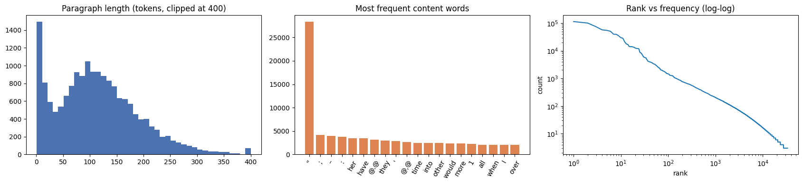
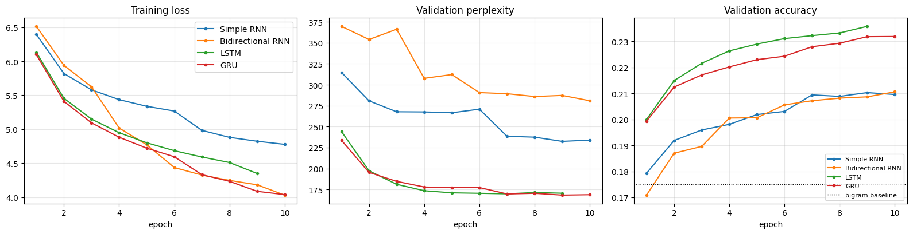
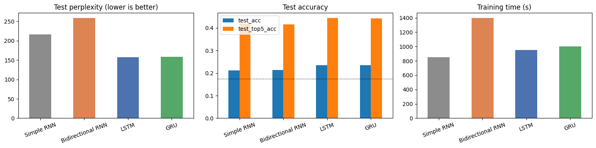
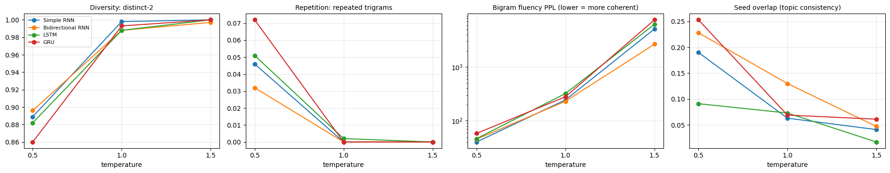

# Autoregressive Text Generation on WikiText-2 (RNN vs BiRNN vs LSTM vs GRU)

**Course:** Foundations of Generative AI (ICT4403), Assignment 2
**Student:** Tetala Rukmender Reddy | Reg. No. 230911326 | Section E

## Problem statement and objective

The goal is to build a word-level autoregressive text generator: given the tokens so far, predict the next token, append it to the input and repeat. Four recurrent architectures are trained for this under the same conditions:

1. Simple RNN
2. Bidirectional RNN
3. LSTM
4. GRU

Objectives:

- describe and preprocess a text dataset, and turn it into input-target sequences for next-word prediction,
- train all four models with the same data, split, layer sizes and training budget,
- compare them on loss, perplexity, accuracy and training time, and on the quality of the generated text (coherence, diversity, contextual consistency, repetition),
- generate text from the same seeds at three sampling temperatures (0.5, 1.0, 1.5), analyse the effect of temperature, and pick the best model for the dataset.

## Dataset

**WikiText-2** (Merity et al., 2016), a standard language modelling benchmark built from Wikipedia articles that editors rated *Good* or *Featured*. The `wikitext-2-v1` version is used. It is already tokenised and has rare words replaced with `<unk>`.

- Dataset link (Hugging Face): https://huggingface.co/datasets/Salesforce/wikitext (config `wikitext-2-v1`)
- Paper: *Pointer Sentinel Mixture Models*, https://arxiv.org/abs/1609.07843

| Split | Paragraphs | Tokens | Unique tokens | `<unk>` share |
|---|---|---|---|---|
| Train | 17,556 | 2,051,910 | 33,277 | 2.66% |
| Validation | 1,841 | 213,886 | 13,776 | 5.48% |
| Test | 2,185 | 241,211 | 14,142 | 6.31% |

**Characteristics.**
- The training split comes from about 600 articles, and validation and test are separate articles (the official split).
- Topics are very mixed: video games, albums and songs, warships and battles, hurricanes, sports seasons, biology and more.
- Case, numbers and punctuation are kept. Hyphens and number separators are written as `@-@`, `@,@` and `@.@`, and section headings appear as lines like `= = Reception = =`.
- Apart from many very short one-line paragraphs, most paragraphs are 50 to 200 tokens long, and the vocabulary has a long tail of rare names.

The mix of topics, the large vocabulary and the many facts (dates, names, chart positions) make this a much harder next-word task than a single book.



### Preprocessing

1. Removed empty lines and heading lines (`= Title =`, `= = Section = =`).
2. Split each paragraph on whitespace (the data is already tokenised) and added an `<eos>` token at the end of every paragraph.
3. Built the vocabulary from the training split: 33,231 tokens (the dataset is already `<unk>`-ed, so no extra filtering is needed).

### Input-target sequences

A sliding window of 20 tokens (stride 1) is the input and the 21st token is the target. Windows are built separately inside each official split, so there is no overlap between training, validation and test text.

```
Senjō no Valkyria 3 : <unk> Chronicles ( Japanese : 戦場のヴァルキュリア3 , lit . Valkyria of the Battlefield 3 )   ->   ,
```

| Split | Input-target pairs |
|---|---|
| Train | 2,024,682 |
| Validation | 211,159 |
| Test | 238,019 |

## Models

All four models share the same pipeline, and only the recurrent layer changes:

`Embedding(33231, 256) -> Dropout(0.3) -> recurrent layer (hidden 512) -> Dropout(0.3) -> Linear(33231)`

| Model | Recurrent layer | Parameters |
|---|---|---|
| Simple RNN | `nn.RNN` (tanh) | 25,948,879 |
| Bidirectional RNN | `nn.RNN(bidirectional=True)`, last forward state joined with last backward state | 43,357,391 |
| LSTM | `nn.LSTM` (input, forget and output gates + cell state) | 27,131,599 |
| GRU | `nn.GRU` (update and reset gates) | 26,737,359 |

Most of the parameters are in the output layer, because it has to score all 33k vocabulary entries. The bidirectional model reads the 20-token context in both directions but never sees the token it has to predict, so it can still generate left to right like the others.

**Training setup (identical for all four):**
- Adam with learning rate 0.001, halved whenever validation loss doesn't improve
- batch size 512, cross-entropy loss, gradient clipping at 1.0, mixed precision on the GPU
- up to 10 epochs, with early stopping after 2 epochs without improvement
- the checkpoint with the lowest validation loss is kept, and seed 42 is reset before each model

## How to run

**Kaggle (recommended)**
1. Create a new notebook and import `notebook/wikitext2_textgen_rnn_lstm_gru.ipynb` (File > Import Notebook).
2. In the settings panel set **Accelerator = GPU** and **Internet = On**. The dataset is downloaded from Hugging Face with the `datasets` library.
3. Run all cells (or *Save Version > Save & Run All*). On a T4 the four models trained for 70 minutes in total, and the full notebook took about 75 minutes. Outputs are written to `/kaggle/working`.

**Locally (a CUDA GPU is strongly recommended)**
```bash
git clone https://github.com/<your-username>/wikitext2-textgen-rnn-lstm-gru.git
cd wikitext2-textgen-rnn-lstm-gru
pip install -r requirements.txt
jupyter notebook notebook/wikitext2_textgen_rnn_lstm_gru.ipynb
```
Outputs go to `notebook/outputs/` when not running on Kaggle.

**Dependencies:** Python 3.10+, PyTorch 2.x, Hugging Face `datasets`, NumPy, pandas, Matplotlib (see `requirements.txt`).

## Repository structure

```
wikitext2-textgen-rnn-lstm-gru/
├── README.md
├── requirements.txt
├── notebook/
│   └── wikitext2_textgen_rnn_lstm_gru.ipynb   # executed notebook with all outputs and analysis
├── results/
│   ├── model_comparison.csv                   # loss, perplexity, accuracy and time per model
│   ├── temperature_metrics.csv                # generation metrics per model and temperature
│   ├── results_summary.md                     # summary written by the notebook
│   ├── dataset_stats.png
│   ├── training_curves.png
│   ├── metric_bars.png
│   └── temperature_effect.png
└── samples/
    └── generated_samples.txt                  # generated text for every model, seed and temperature
```

## Results

Results from the Kaggle run (Tesla T4). Each model is evaluated with its best checkpoint. The test set was never used for any training decision.

| Model | Epochs (best) | Train PPL | Val PPL | Test loss | **Test PPL** | Train acc | Val acc | **Test top-1 acc** | **Test top-5 acc** | Time / epoch | Total time |
|---|---|---|---|---|---|---|---|---|---|---|---|
| Simple RNN | 10 (9) | 60.2 | 232.4 | 5.375 | 215.9 | 25.5% | 21.0% | 21.2% | 41.9% | 85 s | 848 s |
| Bidirectional RNN | 10 (10) | 26.5 | 280.9 | 5.555 | 258.6 | 34.1% | 21.1% | 21.4% | 41.6% | 140 s | 1,398 s |
| **LSTM** | 9 (7) | 52.8 | 169.9 | **5.059** | **157.4** | 28.0% | 23.2% | **23.6%** | **44.4%** | 105 s | 948 s |
| GRU | 10 (9) | 30.3 | **168.3** | 5.064 | 158.2 | 32.5% | 23.2% | 23.4% | 44.3% | 100 s | 1,002 s |

**Baselines on the same test positions**

| Predictor | Test accuracy |
|---|---|
| Always predict the most common token (*the*) | 5.9% |
| Bigram lookup (most frequent follower of the previous token) | 17.5% |
| Best model (LSTM) | **23.6%** |

Total training time for all four models: 70 minutes.




## Model comparison and evaluation

### Quantitative

- **LSTM and GRU are clearly the best**, and almost tied with each other. The LSTM wins on the test set (perplexity 157.4, 23.6% top-1, 44.4% top-5) and the GRU has a slightly lower validation perplexity (168.3 vs 169.9). Their test perplexity is about 27% lower than the Simple RNN's and about 39% lower than the BiRNN's.
- **Every model beats both baselines.** The LSTM is 6 points above the bigram lookup and 4 times better than always guessing *the*. Top-5 accuracy of 44% means the correct token is among the first five guesses almost half the time.
- **The Bidirectional RNN overfits the most.** It has the lowest training perplexity (26.5) but the worst test perplexity (258.6), and 60% more parameters than the LSTM. Its top-1 accuracy matches the Simple RNN's, but it is very overconfident when it's wrong. Reading the context backwards gives no extra information about the next token.
- **The LSTM generalises best.** It has the smallest gap between training and test perplexity, and it is the only model that early-stopped (best epoch 7). The others were still improving slightly at epoch 10.
- **Learning-rate halving shows up in the curves.** The sudden drops in validation perplexity (epoch 7 for the Simple RNN and GRU, epoch 4 for the BiRNN) come right after the learning rate was halved.
- **Speed.** The Simple RNN is the fastest (85 s per epoch), then the GRU (100 s), the LSTM (105 s) and the BiRNN (140 s).
- **Context.** Published LSTM models on WikiText-2 reach around 100 perplexity or lower, but they train on full sequences with longer context and heavy tuning. 157 with a 20-token window and 10 epochs is in a sensible range for this setup.

### Qualitative (same seeds for all models)

To put numbers on text quality, 15 samples of 40 tokens were generated per model and temperature, and scored with:
- *distinct-1/2* for diversity,
- *repeated-trigram rate* for repetition,
- *bigram fluency perplexity*: the generated text scored by a bigram model of the training text, a rough check of local coherence,
- *seed overlap*: the share of the seed's content words that come back in the continuation, a rough check of topic consistency.

| Observation | Simple RNN | BiRNN | LSTM | GRU |
|---|---|---|---|---|
| Coherence | locally OK, switches topic abruptly | locally OK, many repeated names | most grammatical clauses | grammatical, but repeats sentence templates |
| Diversity (distinct-2, T=0.5) | 0.889 | **0.896** | 0.882 | 0.860 |
| Repetition (trigram repeats, T=0.5) | 0.046 | **0.032** | 0.051 | 0.072 |
| Fluency PPL (T=0.5) | **40.5** | 45.6 | 46.7 | 58.3 |
| Contextual consistency | keeps the seed's domain briefly, then jumps topic (game release to *"the House of Commons"*) | stays in the seed's domain, keeps reusing its entities (*"the Royal Navy"*) | moves to related topics (album to song to chart), facts sometimes contradict | stays closest to the seed's wording, partly by repeating it, facts sometimes contradict |
| Contextual consistency proxy: seed overlap (T=0.5) | 0.190 | 0.228 | 0.091 | **0.253** |
| Greedy decoding loops on | "The song was released on September 7, 2011." | song titles in quotes | "The album was released on September 13, 2011" | "The game was released in June 2015" |

- **Domain is kept, facts are not.** All models stay in the right domain for each seed: the game seed leads to release dates and platforms, the album seed to reviews and charts, and the war seed to navies and brigades. Facts don't hold together, though: a game *"peaked at number one on the Billboard Hot 100"*, and a ship is *"commissioned by the British fleet"* and then *"by the French Navy"*. Music and game articles get mixed up a lot.
- **The seed-overlap metric should be read with care.** The GRU's high score is partly a side effect of its repetition (it keeps reusing *"The game was released"*). The LSTM's low score comes from it moving to a related topic (album, then song, then chart) instead of repeating the seed's words.

Example at T = 0.8, seed *"During the Second World War , the ship was"*:
- GRU: *"scrapped on the Austro-Hungarian Navy vessel in the mid-Atlantic fleet. / The Derfflinger vessel prepared to destroy the French ships created in a fleet ironclad"*
- Simple RNN: *"sent to that the soldiers had been lifted by the German cruiser SMS Breslau at Romani, and launched from 1 May 1941."*

## Sampling temperature analysis

Seeds: *"The game was released in North America in"*, *"The album received positive reviews from music critics , who"* and *"During the Second World War , the ship was"*.

| Model | T | distinct-1 | distinct-2 | repeated trigrams | bigram fluency PPL | seed overlap |
|---|---|---|---|---|---|---|
| Simple RNN | 0.5 | 0.688 | 0.889 | 0.046 | 40.5 | 0.190 |
| | 1.0 | 0.865 | 0.998 | 0.000 | 245.1 | 0.063 |
| | 1.5 | 0.958 | 1.000 | 0.000 | 5,096.3 | 0.041 |
| Bidirectional RNN | 0.5 | 0.673 | 0.896 | 0.032 | 45.6 | 0.228 |
| | 1.0 | 0.832 | 0.988 | 0.000 | 231.4 | 0.130 |
| | 1.5 | 0.925 | 0.997 | 0.000 | 2,659.0 | 0.047 |
| LSTM | 0.5 | 0.648 | 0.882 | 0.051 | 46.7 | 0.091 |
| | 1.0 | 0.857 | 0.988 | 0.002 | 322.3 | 0.073 |
| | 1.5 | 0.955 | 1.000 | 0.000 | 6,226.4 | 0.017 |
| GRU | 0.5 | 0.652 | 0.860 | 0.072 | 58.3 | 0.253 |
| | 1.0 | 0.837 | 0.993 | 0.000 | 280.6 | 0.069 |
| | 1.5 | 0.967 | 1.000 | 0.000 | 7,538.2 | 0.061 |



- **T = 0.5 (low).** The most coherent and Wikipedia-like text, with the lowest fluency perplexity (40 to 58). It is also the most repetitive and generic (3 to 7% repeated trigrams). Release dates, chart positions and *"the Royal Navy"* keep coming back:
  > GRU: *"The game was released on September 25, 2011. The game was released on September 10, 2012, and was released as a digital download"*
- **T = 1.0 (medium).** Diversity is almost maximal and repetition disappears, but fluency perplexity is 5 to 7 times higher. The text drifts away from the seed's topic within a sentence:
  > LSTM, game seed: *"Telugu cinema which included Anderson's new musical release production from the rhythm programme"*
- **T = 1.5 (high).** Word salad, with fluency perplexity in the thousands:
  > LSTM: *"share me Nick Original links on Buffalo Yorkshire 75, 2015 Window 400 48 mobile shipments room"*

Raising the temperature increases diversity and removes repetition, but coherence and topic consistency fall quickly. Because the vocabulary is large and has a long tail of rare names, the model's distribution is already quite flat, so even T = 1.0 is too random. **A temperature of about 0.5 to 0.8** gives the best balance for this dataset.

All generated samples are in [`samples/generated_samples.txt`](samples/generated_samples.txt).

## Conclusion

The **LSTM** is the best-performing model for autoregressive generation on WikiText-2 in this experiment:

- lowest test loss (5.059) and perplexity (157.4), and highest top-1 (23.6%) and top-5 (44.4%) accuracy, well above the 17.5% bigram baseline,
- the smallest gap between training and test perplexity, and the only model that converged within 10 epochs,
- faster to train than the GRU, with grammatical, on-topic samples at T = 0.5 to 0.8.

The GRU is practically tied and is an equally good choice. The Simple RNN is the fastest but clearly less accurate. The Bidirectional RNN is the least suitable: it has the most parameters and overfits the most, and its backward pass can't help predict the next token. The recommended setup is an **LSTM sampled at a temperature of about 0.5 to 0.8**.
